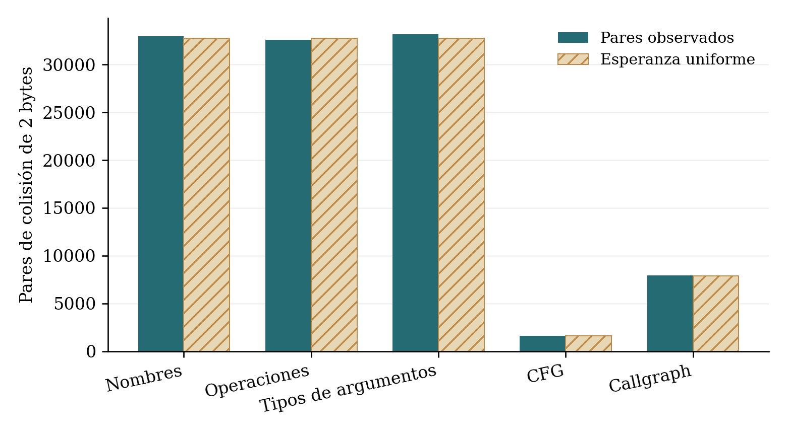

# Estudio de colisiones de CCBHash

[](https://doi.org/10.5281/zenodo.24406637)
[](LICENSE)
[](output/pdf/ESTUDIO_CCBHASH.pdf)

**Javier González Casares** · versión 1.3 · 2026

**Firma igual no implica comportamiento igual.** Este estudio analiza, con métodos reproducibles, cuándo y por qué el fuzzy hash [CCBHash](https://github.com/pblprz/ccbhash) asigna la misma firma a funciones distintas. Separa cada mecanismo y aporta testigos verificables y recuentos exactos sobre corpus públicos. La implementación original se evalúa sin modificar.

> **English summary.** A reproducible collision study of CCBHash, a function-level fuzzy hash for malware similarity. It separates three sources of equal signatures: information discarded before hashing, numeric quantization and 16-bit digest collisions. The study builds 256 x86-64 functions with an identical signature and provably different return values, compiles a 64-function family for 4 architectures and 5 optimization levels, re-extracts 4 public binaries with two radare2 versions, and counts every equal-signature pair among 7.2 million vectors reconstructed from a public Zenodo deposit. The paper is in Spanish ([Markdown](output/ESTUDIO_CCBHASH.md), [PDF](output/pdf/ESTUDIO_CCBHASH.pdf)).

## Documentos

| Documento | Contenido |
| --- | --- |
| [Manuscrito](output/ESTUDIO_CCBHASH.md) ([PDF](output/pdf/ESTUDIO_CCBHASH.pdf)) | Método, resultados y demostraciones |
| [Hallazgos para los autores](docs/HALLAZGOS_PARA_AUTORES.md) | Once observaciones sobre la implementación, con evidencia y propuestas |
| [Reproducción](docs/REPRODUCCION.md) | Entorno fijado, campañas completas y verificadores |
| [Protocolo](study/PROTOCOL.md) | Diseño de las campañas; documento local, sin prerregistro externo |
| [Literatura](study/LITERATURA.md) | Fuentes consultadas y su relación con el estudio |

## Resultados principales

### 256 funciones con la misma firma y retornos distintos

Las rutinas `f_c(x) = 3(x + c) - 1 mod 2^32`, con `c` de 0 a 255, solo se diferencian en un inmediato, y CCBHash no representa los inmediatos. Para dos constantes distintas, los retornos difieren en `3(c - d)`, que nunca es cero módulo `2^32`, así que ningún par coincide en ninguna entrada. Los 32.640 pares colisionan con digests de 2, 4 y 8 bytes, tanto con radare2 5.8.8 como con 6.0.4. La fórmula se comprueba con 8.192 emulaciones y con la recuperación simbólica de la expresión de retorno.

### Orden, multiplicidad y condiciones de salto

Reordenar operaciones, cambiar cuántas veces aparece cada una o invertir `je` por `jne` también produce firmas idénticas en rutinas con retornos distintos demostrados.

### Cada coincidencia tiene una causa identificable

Dos firmas son iguales si y solo si coinciden sus seis digests textuales y sus siete códigos numéricos. Por eso cada coincidencia puede atribuirse a la información perdida antes del hash, a la cuantización o a la compresión de 16 bits.

| Corpus | Pares con código distinto y firma igual | Atribuibles a la compresión de 16 bits |
| --- | --- | --- |
| 4 binarios de control (Git, libpng, VLC, zlib) | 2 de 109.277 | 0 |
| Depósito público completo (7.224.074 funciones) | 25.452.152 de unos 26 billones | 522 |

En el depósito, casi todas las coincidencias existen antes de comprimir. No se ha medido cuántas reúnen variantes de una misma función, que es lo que un fuzzy hash debe agrupar. **Estas cifras no se presentan como tasas de error**: la divergencia de comportamiento solo se afirma donde está demostrada.

### Compilación real en cuatro arquitecturas

Una familia de 64 funciones en C, compilada con Clang 19.1.7 para x86-64, ARM32, AArch64 y RISC-V64 en los niveles O0 a Os, da 1.280 funciones y 818.560 parejas. El umbral 0,58 se elige solo con la mitad de calibración. En la mitad de evaluación recupera el 62,1% de las parejas equivalentes y acepta el 44,5% de las parejas con retorno distinto.

<p align="center">
  
  
</p>

## Qué significa y qué no

- CCBHash es útil para **recuperar candidatos** de similitud, pero una firma idéntica no basta para afirmar que dos funciones se comportan igual.
- Ampliar los digests elimina las colisiones de compresión observadas, pero no recupera los inmediatos, el orden, las multiplicidades ni las condiciones que la representación ya descartó.
- No se estima una tasa de falsos positivos en malware: los recuentos describen corpus concretos.
- El objetivo es aportar evidencia útil para mejorar la herramienta. Las propuestas concretas están en [Hallazgos para los autores](docs/HALLAZGOS_PARA_AUTORES.md).

## Verificar los resultados

El código de CCBHash se incluye como submódulo fijado al commit estudiado, por lo que hay que clonar con `--recursive`. Con Python 3.12 (Windows, macOS o Linux):

```bash
git clone --recursive https://github.com/i12gocaj/ccbhash-collision-study.git
cd ccbhash-collision-study
python -m venv .venv
.venv/bin/pip install -r study/requirements.txt
.venv/bin/python study/verify_results.py
.venv/bin/python study/verify_extensions.py
.venv/bin/python study/verify_compiled.py
```

En Windows, sustituye `.venv/bin/` por `.venv\Scripts\`. Los tres verificadores tardan unos segundos y recalculan digests, intervalos, pares y testigos a partir de los datos del repositorio, con cálculos separados de los generadores.

Las comprobaciones del corpus completo (`verify_large.py`, `publication_audit.py`) y la auditoría de los binarios públicos (`run_audit.py`) necesitan el [paquete de Zenodo](https://doi.org/10.5281/zenodo.24406637). La reproducción íntegra, con radare2 fijado, la descarga verificada del depósito de 29 GB y todas las campañas, se describe en [docs/REPRODUCCION.md](docs/REPRODUCCION.md).

Los verificadores se han ejecutado en Windows 11 (entorno original) y en macOS arm64. En macOS se replicó además la colisión de la familia controlada con el `ccbhash.py` original y radare2 6.0.4 WASI.

## Estructura del repositorio

```text
ccbhash-src/      Objeto de estudio: commit fd40d49 de pblprz/ccbhash, sin modificar (submódulo)
study/            Generadores, adaptador de esquema y verificadores
study/data/       Entradas propias: 256 PE controlados, rutinas adicionales y objetos compilados
study/results/    Resultados JSON y CSV de todas las campañas y sus verificaciones
output/           Manuscrito, PDF y figuras (PNG, SVG, PDF y CSV con sus datos)
docs/             Hallazgos para los autores y guía de reproducción
```

Los datos pesados no están en Git: las columnas de firmas del corpus completo (1,2 GB), los identificadores de registros, las muestras de validación (10 GB) y los binarios de BinRankBench. Todo ello está en el [paquete reproducible de Zenodo](https://doi.org/10.5281/zenodo.24406637) (2,2 GB), que incluye un manifiesto SHA-256 de cada fichero.

## Cómo se hizo

El estudio se ha desarrollado con asistencia de herramientas de IA para el código, el análisis y la redacción. Los verificadores, hechos también con esa asistencia, recalculan los resultados principales, y 9 de las 11 tablas del manuscrito se contrastan automáticamente con los ficheros de resultados; el texto se revisó aparte. Son comprobaciones internas: no sustituyen una revisión por pares ni una réplica externa. Las afirmaciones de comportamiento se apoyan en demostraciones algebraicas, emulación y ejecución simbólica. Las correcciones y comentarios son bienvenidos a través de los [issues](https://github.com/i12gocaj/ccbhash-collision-study/issues).

## Trabajos relacionados

- Pérez Jiménez, P.; Onieva, J. A.; Fernández, G. (2022). *CCBHash (Compound Code Block Hash) para Análisis de Malware*. XVII RECSI, pp. 168-173.
- Onieva, J. A.; Pérez Jiménez, P.; López, J. (2024). *Malware similarity and a new fuzzy hash: Compound Code Block Hash (CCBHash)*. Computers & Security 142, 103856. [doi:10.1016/j.cose.2024.103856](https://doi.org/10.1016/j.cose.2024.103856)
- Bucci, V.; Olukoya, O.; Martínez del Rincón, J. (2026). *Bridging the compilation gap: a taxonomy and evaluation of fuzzy hashes for binary function similarity analysis*. Computers & Security 171, 105077. [doi:10.1016/j.cose.2026.105077](https://doi.org/10.1016/j.cose.2026.105077). Su [depósito en Zenodo](https://doi.org/10.5281/zenodo.20439493) es el corpus amplio de este estudio.

La lista completa de referencias está en el manuscrito.

## Cómo citar

> González Casares, J. (2026). *Estudio de colisiones de CCBHash: paquete reproducible* (versión 1.3). Zenodo. https://doi.org/10.5281/zenodo.24406637

```bibtex
@dataset{gonzalez_casares_2026_ccbhash,
  author    = {González Casares, Javier},
  title     = {Estudio de colisiones de CCBHash: paquete reproducible},
  year      = {2026},
  version   = {1.3},
  publisher = {Zenodo},
  doi       = {10.5281/zenodo.24406637},
  url       = {https://doi.org/10.5281/zenodo.24406637}
}
```

## Licencias

| Componente | Licencia |
| --- | --- |
| Scripts del estudio | MIT ([LICENSE](LICENSE)) |
| CCBHash (submódulo `ccbhash-src`) | Apache-2.0, de sus autores |
| Paquete reproducible en Zenodo | CC BY 4.0 |
| Datos derivados del depósito de Bucci et al. | CC BY 4.0, con su atribución en `study/results/literature/zenodo_record.json` |

Los binarios de `study/data` son rutinas benignas generadas por el propio estudio; no contienen malware.
