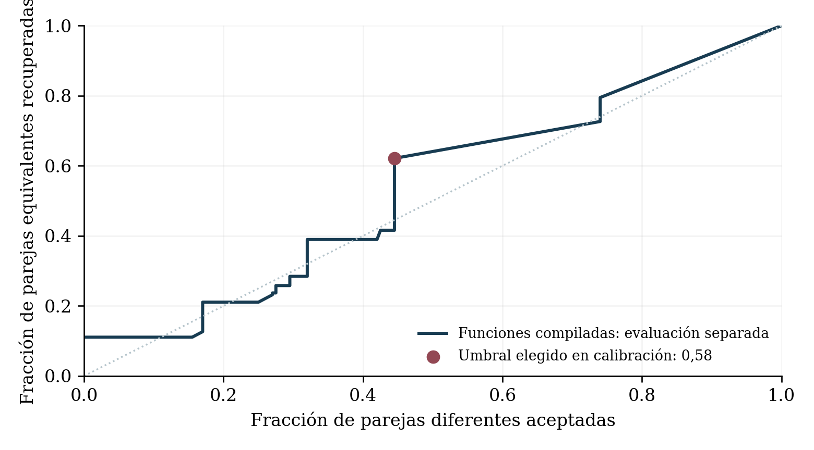

# Estudio de colisiones de CCBHash

*Javier González Casares, 2026*

[](https://doi.org/10.5281/zenodo.24406637) [](LICENSE)

**Firma igual no implica comportamiento igual.** Este estudio analiza con métodos reproducibles cuándo y por qué el fuzzy hash [CCBHash](https://github.com/pblprz/ccbhash) asigna la misma firma a funciones distintas. Mide cada mecanismo por separado y aporta testigos verificables y recuentos exactos sobre corpus públicos.

> **English summary.** A reproducible collision study of CCBHash, a function-level fuzzy hash for malware similarity. It separates information lost before hashing, numeric quantization and 16-bit digest collisions. We build 256 x86-64 functions with an identical signature and provably different return values, compile a 64-function family for 4 architectures and 5 optimization levels, re-extract 4 public binaries with two radare2 versions, and count all equal-signature pairs among 7.2 million reconstructed vectors from a public Zenodo deposit. The original implementation is kept unmodified. Paper in Spanish: [`output/ESTUDIO_CCBHASH.md`](output/ESTUDIO_CCBHASH.md) / [PDF](output/pdf/ESTUDIO_CCBHASH.pdf).

| Documento | Para qué |
| --- | --- |
| [Manuscrito](output/ESTUDIO_CCBHASH.md) ([PDF](output/pdf/ESTUDIO_CCBHASH.pdf)) | Método, resultados y demostraciones |
| [Hallazgos para los autores](docs/HALLAZGOS_PARA_AUTORES.md) | Once observaciones sobre la implementación, con evidencia y propuestas |
| [Reproducción](docs/REPRODUCCION.md) | Entorno fijado, campañas completas y verificadores |
| [Protocolo](study/PROTOCOL.md) | Diseño definido antes de ejecutar las campañas |
| [Literatura](study/LITERATURA.md) | Fuentes consultadas y su relación con el estudio |

## Resultados principales

**1. 256 funciones con la misma firma y retornos distintos.** Las rutinas `f_c(x) = 3(x + c) - 1 mod 2^32`, con `c` de 0 a 255, solo se diferencian en un inmediato, y CCBHash no lo representa. Para dos constantes distintas los retornos difieren en `3(c - d)`, que nunca es cero módulo `2^32`: ningún par coincide en ninguna entrada. Los 32.640 pares colisionan con digests de 2, 4 y 8 bytes, en radare2 5.8.8 y 6.0.4. Se ha comprobado mediante emulación (8.192 casos) y recuperación simbólica de la expresión de retorno.

**2. Otros mecanismos.** Reordenar operaciones, cambiar su multiplicidad e invertir `je`/`jne` también producen firmas completas iguales con retornos distintos demostrados.

**3. Cada coincidencia tiene una causa identificable.** Dos firmas son iguales si y solo si coinciden los seis digests textuales y los siete códigos numéricos. El estudio atribuye cada coincidencia a la pérdida de información antes del hash, a la cuantización o a la compresión de 16 bits.

| Corpus | Pares con código diferente y firma igual | Debidos a la compresión de 16 bits |
| --- | --- | --- |
| 4 binarios de control (Git, libpng, VLC, zlib) | 2 de 109.277 | 0 (ninguna colisión completa) |
| Depósito público completo, 7.224.074 vectores | 25.452.152 de 2,6 × 10¹³ | 522 |

En el depósito, casi todas las coincidencias existen antes de comprimir. Allí reúnen sobre todo variantes de compilación de una misma función, que es lo que un fuzzy hash debe agrupar, y **no se presentan como tasas de error**. La divergencia de comportamiento solo se afirma donde está demostrada.

**4. Compilación real.** Una familia de 64 funciones en C compilada con Clang 19.1.7 para x86-64, ARM32, AArch64 y RISC-V64, en O0 a Os, produce 1.280 funciones y 818.560 parejas. Con el umbral 0,58, elegido solo en calibración, la evaluación separada recupera el 62,1% de las parejas equivalentes y acepta el 44,5% de las parejas con retorno distinto.

<p align="center">
  
  
</p>

## Qué significa y qué no

- CCBHash es útil para **recuperar candidatos** de similitud. Una firma idéntica no basta para afirmar que dos funciones se comportan igual.
- Ampliar los digests elimina las colisiones de compresión observadas, pero no recupera inmediatos, orden, multiplicidades ni condiciones que la representación ya descartó.
- No se estima una tasa de falsos positivos en malware: los recuentos describen corpus concretos.
- El objetivo es aportar evidencia para mejorar la herramienta. Las propuestas concretas están en [docs/HALLAZGOS_PARA_AUTORES.md](docs/HALLAZGOS_PARA_AUTORES.md).

## Estructura

```text
ccbhash-src/       Objeto de estudio: commit fd40d49 de pblprz/ccbhash, sin modificar (Apache-2.0)
study/             Generadores, adaptador de esquema y verificadores (MIT)
study/data/        Entradas propias: 256 PE controlados, rutinas adicionales y objetos compilados
study/results/     Resultados JSON/CSV de todas las campañas y sus verificaciones
output/            Manuscrito, PDF y figuras (PNG, SVG, PDF y CSV de datos)
docs/              Hallazgos para los autores y guía de reproducción
```

Los datos pesados no están en Git: las columnas de firmas del corpus completo (1,2 GB), los identificadores de registros, las muestras de validación (10 GB) y los binarios de BinRankBench. Se distribuyen en el paquete reproducible publicado en Zenodo, [DOI 10.5281/zenodo.24406637](https://doi.org/10.5281/zenodo.24406637) (`CCBHASH_ESTUDIO_REPRODUCIBLE.zip`, 2,2 GB), que incluye el manifiesto SHA-256 de todos los ficheros.

## Verificar en 5 minutos

El código de CCBHash se incluye como submódulo fijado al commit estudiado, así que hay que clonar con `--recursive`. Con Python 3.12 en Windows, macOS o Linux:

```bash
git clone --recursive https://github.com/i12gocaj/ccbhash-collision-study.git
```

```bash
python -m venv .venv
```

```bash
.venv/bin/pip install -r study/requirements.txt
```

```bash
.venv/bin/python study/verify_results.py
```

```bash
.venv/bin/python study/verify_extensions.py
```

```bash
.venv/bin/python study/verify_compiled.py
```

En Windows, el ejecutable es `.venv\Scripts\python`. Estos verificadores recalculan los digests, los intervalos, los pares y los testigos a partir de los datos incluidos en el repositorio, con cálculos separados de los generadores.

`verify_large.py` y `publication_audit.py` necesitan además los datos del paquete completo, y `run_audit.py` necesita los binarios de BinRankBench. La reproducción íntegra (radare2 fijado, descarga verificada del depósito de 29 GB y todas las campañas) está en [docs/REPRODUCCION.md](docs/REPRODUCCION.md).

Los verificadores se han ejecutado en Windows 11 (entorno original) y en macOS sobre arm64. En macOS se replicó además la colisión de la familia controlada con el `ccbhash.py` original y radare2 6.0.4 WASI.

## Trabajos relacionados

- Pérez Jiménez, Onieva y Fernández (2022), *CCBHash para Análisis de Malware*, RECSI XVII.
- Onieva, Pérez Jiménez y López (2024), *Malware similarity and a new fuzzy hash: CCBHash*, Computers & Security 142. [DOI 10.1016/j.cose.2024.103856](https://doi.org/10.1016/j.cose.2024.103856)
- Bucci, Olukoya y Martínez del Rincón (2026), *Bridging the compilation gap*, Computers & Security 171. [DOI 10.1016/j.cose.2026.105077](https://doi.org/10.1016/j.cose.2026.105077). Su depósito [Zenodo 20439493](https://zenodo.org/records/20439493) es el corpus amplio de este estudio.

La lista completa de referencias está en el manuscrito.

## Citar

Consulta [`CITATION.cff`](CITATION.cff); GitHub ofrece el formato con el botón *Cite this repository*.

## Licencias

- Scripts del estudio: MIT ([study/LICENSE](study/LICENSE)).
- CCBHash: Apache-2.0 ([ccbhash-src/LICENSE](ccbhash-src/LICENSE)).
- Depósito de Zenodo: CC BY 4.0, con su atribución en `study/results/literature/zenodo_record.json`.

Los binarios de `study/data` son rutinas benignas generadas por el estudio; no contienen malware.
