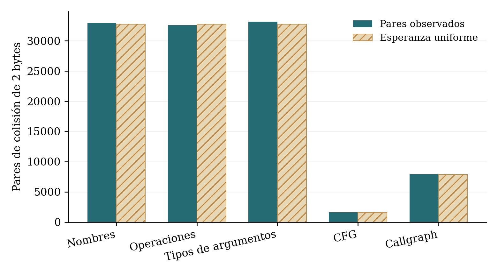
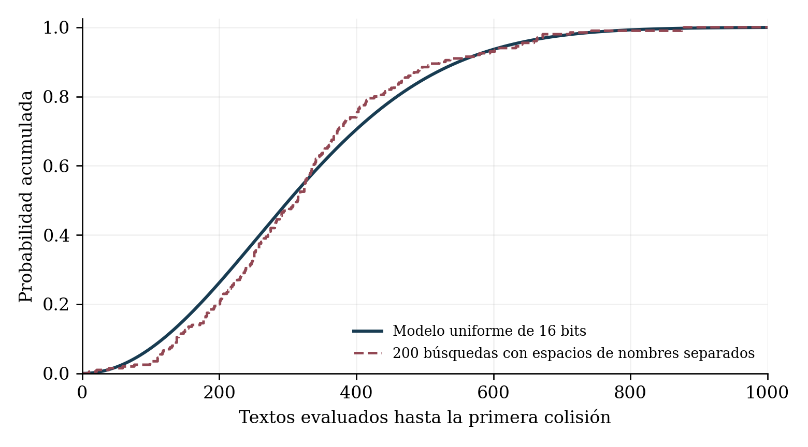
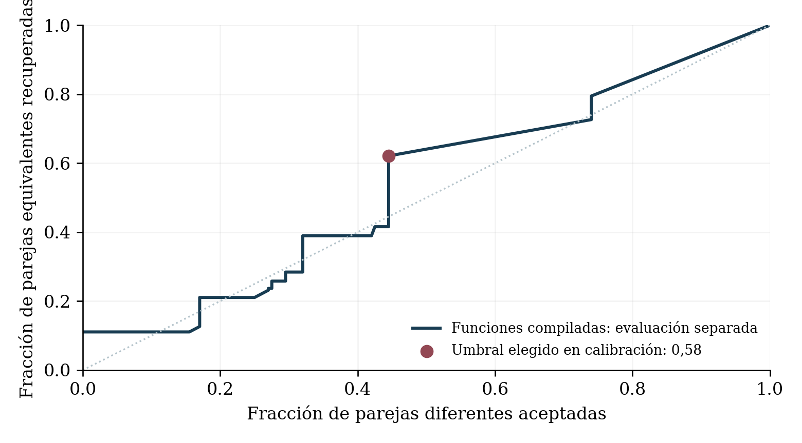
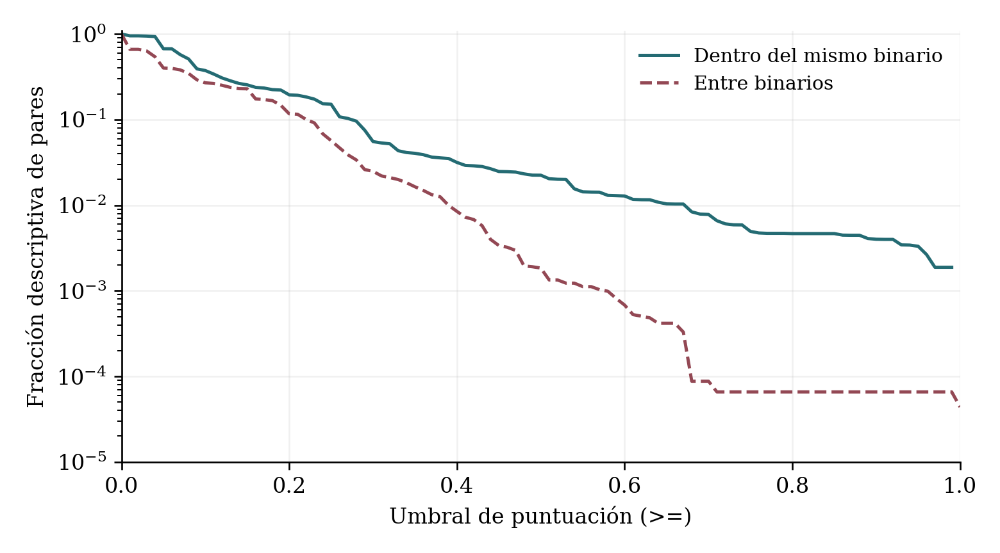
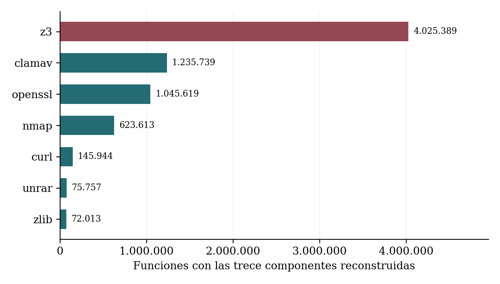

# Estudio de colisiones de CCBHash

Mecanismos, ejemplos verificables y resultados sobre la implementación pública

## Resumen

CCBHash describe una función mediante trece componentes y compara sus coincidencias con una suma ponderada. Esa descripción facilita la búsqueda de código parecido, pero también permite que funciones distintas reciban exactamente la misma firma. Este estudio examina dónde se pierde la información, separa esa pérdida de las colisiones del hash y aporta ejemplos que pueden reproducirse.

El resultado principal es una familia de 256 funciones x86-64 con la misma firma y valores de retorno diferentes para cualquier entrada de 32 bits. Sus 32.640 pares coinciden también al ampliar los digests textuales de dos a cuatro y ocho bytes. Otros ejemplos muestran el efecto del orden de las instrucciones, de sus multiplicidades y de la normalización de una condición de salto. La evaluación reúne enumeraciones de componentes, búsquedas de primera colisión, dos extracciones de cuatro binarios de control y una familia compilada en cuatro arquitecturas. Se procesan además los 5.489 perfiles del depósito público completo y se cuentan todas las parejas de sus 7.224.074 vectores reconstruidos. Todas las campañas del protocolo y su ampliación han terminado y han superado la verificación interna, realizada con cálculos separados de los generadores.

La conclusión es directa: la igualdad de esta firma no certifica igualdad de comportamiento. El código, las entradas, los testigos y los resultados se acompañan de instrucciones de reproducción.

## 1. La pregunta y los antecedentes

Una firma de similitud necesita conservar unas diferencias y pasar por alto otras. Dos compilaciones de la misma función pueden tener bytes distintos; tratarlas como completamente ajenas sería poco útil. Sin embargo, una representación que elimina demasiada información puede reunir funciones que devuelven resultados diferentes. La cuestión de este trabajo es identificar esas coincidencias en el CCBHash publicado y comprobar qué las causa.

Se evalúa el repositorio público `pblprz/ccbhash`, en el commit fijado en el anexo. CCBHash se presentó en RECSI 2022 [1] y se desarrolló en Computers & Security en 2024 [2]. Esos trabajos sitúan la propuesta en la comparación de malware mediante características de código. La revisión bibliográfica sirve para entender esa finalidad; las mediciones siguientes se han obtenido sobre la implementación, que se conserva sin modificar.

La búsqueda también localizó la evaluación de Ross, Olukoya y Martínez del Rincón sobre detección de código vulnerable en malware [3, 4], y la evaluación de similitud entre funciones de Bucci, Olukoya y Martínez del Rincón [5-7]. De esta última se reutilizan cuatro binarios de control de BinRankBench y el depósito bruto completo asociado al artículo. Su variante de caracterización difiere del código aquí estudiado: por eso se extraen de nuevo las características y se recalculan las firmas con el núcleo original.

Se consultaron los textos completos de [1-3, 5], sus métodos y resultados, junto con los repositorios asociados. Ross y sus colaboradores estudian clasificación y recuperación de funciones vulnerables; las etiquetas del malware se asignan al archivo y su evaluación agrupa coincidencias para relacionarlas con esas etiquetas [3]. Bucci y sus colaboradores estudian recuperación de funciones entre compilaciones, con filtros de procedencia, duplicados y disponibilidad de características [5]. Esas tareas responden a preguntas diferentes de la igualdad exacta de las trece componentes. Aquí se conserva esa distinción: las tasas publicadas no se convierten en tasas propias de colisión.

Las referencias sobre terminología y evaluación de hashes de similitud [8-11] ayudan a separar igualdad, semejanza y errores de una tarea concreta. El registro bibliográfico identifica las fuentes y la fecha de consulta; los experimentos propios se distinguen de los resultados de otros autores.

## 2. Qué se compara y cómo se cuenta

La firma se obtiene en tres etapas. Primero se extrae y reduce la información de la función. Después se comprimen seis textos con BLAKE2b de dos bytes y se agrupan siete cantidades en intervalos. Finalmente, la comparación suma los pesos de las componentes iguales.

| Componente | Representación en la firma original | Peso |
| --- | --- | --- |
| Tipos de operaciones | Digest textual de 16 bits | 0,25 |
| Grafo de flujo de control, CFG | Digest textual de 16 bits | 0,16 |
| Complejidad ciclomática | Uno de 16 códigos | 0,15 |
| Llamadas salientes, outdegree | Uno de 16 códigos | 0,09 |
| Número de instrucciones | Uno de 256 códigos | 0,07 |
| Grafo de llamadas, callgraph | Digest textual de 16 bits | 0,06 |
| Tipos de argumentos | Digest textual de 16 bits | 0,04 |
| Tipos de variables locales | Digest textual de 16 bits | 0,04 |
| Número de variables y argumentos | Uno de 16 códigos | 0,04 |
| Número de bloques | Uno de 16 códigos | 0,04 |
| Llamadas entrantes, indegree | Uno de 16 códigos | 0,03 |
| Tamaño del marco de pila | Uno de 16 códigos | 0,02 |
| Nombre | Digest textual de 16 bits | 0,01 |

La suma es uno. La capacidad nominal de las componentes equivale a 128 bits, pero eso no convierte la firma en una salida aleatoria uniforme de 128 bits. Los atributos están relacionados y algunos pueden permanecer constantes en un conjunto entero de funciones. La implementación entrega un diccionario; su JSON tampoco es una codificación binaria de dieciséis bytes.

Se considera colisión completa la igualdad exacta de las trece componentes. Una puntuación de 0,90 se registra como una coincidencia alta, sin llamarla colisión completa. Dentro de cada clase de tamaño k se cuentan k(k−1)/2 pares no ordenados. Se informan también las clases, las firmas distintas y el excedente: el número de entradas menos el de firmas distintas. Los duplicados de entrada se identifican antes de interpretar una igualdad como colisión.

Para explicar el mecanismo se conserva el vector anterior a la compresión. Si dos funciones ya tienen el mismo vector, el hash no introduce su coincidencia: la pérdida se produjo al extraer o reducir la información. Si dos textos diferentes tienen el mismo digest, existe una colisión de compresión. Si dos cantidades distintas entran en el mismo intervalo, existe una coincidencia por cuantización. Estas causas pueden coexistir.

Esta separación es exhaustiva para la construcción estudiada. Sean t₁…t₆ los seis textos y n₁…n₇ las siete cantidades. Dos firmas son iguales si, y solo si, coinciden los seis digests H(tᵢ) y los siete códigos de intervalo Qⱼ(nⱼ). En cada texto, la coincidencia procede de textos iguales o de una colisión del digest; en cada cantidad, de valores iguales o de su agrupación en un intervalo. No existe una cuarta etapa que pueda introducir una colisión completa. La demostración consiste en comparar las trece componentes del diccionario; el comparador se comprueba además en sus 8.192 patrones posibles de igualdad. La clasificación cubre los mecanismos, mientras que los experimentos aportan sus testigos y sus recuentos.

La diferencia de bytes no basta para demostrar diferencia de comportamiento. Los ejemplos controlados incluyen una fórmula de retorno y una comprobación mediante emulación. En el corpus público, donde no se ha establecido la equivalencia semántica de cada pareja, los recuentos se presentan como descripciones de la muestra.

### Extracción y controles de fidelidad

La extracción utiliza un adaptador explícito de esquema. Renombra claves de direcciones y variables; cuando `afij` no incluye variables, obtiene las listas reales de `afvj`. Conserva las entradas, sus tipos y su campo `kind`. No añade características, ni cambia los intervalos, los digests, los pesos o los reductores de CCBHash. Se ejecutan ambas entradas públicas de la API con ese adaptador sobre toda la familia controlada.

Se utiliza radare2 5.8.8 nativo y radare2 6.0.4 en su distribución oficial WASI. El alojamiento WASI se describe en el anexo, con sus hashes y opciones. Las dos extracciones se mantienen separadas para mostrar el efecto de la versión. Una segunda implementación reconstruye las características desde los JSON brutos y coteja los bytes de las instrucciones con los PE y ELF originales.

## 3. Funciones distintas con una firma idéntica

### Una familia de 256 funciones

Los binarios controlados contienen la misma secuencia de diez instrucciones, con un inmediato c que toma los valores de 0 a 255. La entrada x se recibe en ECX y el resultado se devuelve en EAX. Para cada función:

f_c(x) = 3(x + c) − 1, módulo 2³².

Para dos constantes distintas c y d, la diferencia de resultados es 3(c−d), módulo 2³². Como 3 es invertible en ese módulo y c y d están entre 0 y 255, esa diferencia nunca vale cero. Por tanto, cada par devuelve valores distintos para toda entrada de 32 bits. La prueba se refiere al valor de retorno de estas rutinas, sin atribuirles equivalencia o divergencia de otras propiedades del programa.

Los 256 PE tienen SHA-256 diferentes. Radare2 recupera una función admisible de cada uno y CCBHash les asigna el mismo vector: nombre `entry0`, diez instrucciones, un bloque, el mismo conjunto de operaciones y las mismas características restantes. El inmediato, que cambia el resultado, no participa en la descripción de operaciones.

| Resultado de la familia | Valor |
| --- | --- |
| Funciones y ficheros distintos | 256 |
| Vectores de características distintos | 1 |
| Firmas distintas, con digests de 2, 4 u 8 bytes | 1 |
| Pares de colisión completa | 32.640 |
| Excedentes de firma | 255 |
| Comprobaciones de retorno mediante emulación | 8.192 |

La emulación utiliza 32 entradas por función, incluidas fronteras del dominio y entradas pseudoaleatorias fijadas por semilla. Lee los bytes del propio PE y comprueba la fórmula. Esa comprobación detecta errores de generación o ejecución; el argumento algebraico es el que cubre todas las entradas. Las dos entradas de la API, en las dos versiones de radare2, completan 1.024 llamadas sin errores de extracción y reproducen la clase de 256 firmas iguales.

Una comprobación simbólica separada decodifica los bytes de los PE y recupera sus expresiones de retorno módulo 2³². Verifica la fórmula sin enumerar entradas y cubre también las siete rutinas adicionales, con sus dos caminos en los ejemplos condicionales.

La igualdad persiste con digests de cuatro y ocho bytes porque los textos ya eran iguales. Ampliar el hash puede evitar coincidencias entre textos diferentes, pero no recupera el inmediato que la representación dejó fuera.

### Orden, multiplicidades y condiciones de salto

La ampliación añade siete rutinas PE64. Una reutiliza el caso base de la familia anterior; no se cuenta como un nuevo artefacto independiente. Las demás permiten aislar otras pérdidas de información.

| Cambio evaluado | Retornos o propiedad comprobada | Resultado |
| --- | --- | --- |
| Intercambiar multiplicación y resta | 3x−1 frente a 3x−5 | Firma completa igual |
| Cambiar una suma por una resta sin cambiar el conjunto de tipos | 3x−1 frente a 3x−3 | Firma completa igual |
| Comparar las dos variantes anteriores | 3x−5 frente a 3x−3 | Firma completa igual |
| Invertir `je` y `jne` | Retornos 1 y 2 intercambiados para toda entrada | Firma completa igual |
| Añadir un NOP: 41 frente a 42 instrucciones | Mismo retorno 3x−1 | Firma completa igual |

Las diferencias aritméticas de dos o cuatro unidades no se anulan módulo 2³². En el ejemplo condicional, las dos ramas devuelven valores opuestos para cada entrada. Son cuatro parejas con diferencia de retorno demostrada. La pareja de NOP es un control de invariancia útil: conserva el comportamiento, aunque cambia el número bruto de instrucciones. Su igualdad combina la omisión de NOP con la pertenencia de 41 y 42 al mismo intervalo numérico.

Las siete rutinas suman 224 comprobaciones adicionales de emulación; las dos versiones de radare2 y los tres tamaños de digest reproducen las cinco coincidencias. Así, los ejemplos no dependen únicamente de cambiar inmediatos. CCBHash retiene tipos distintos de operaciones, pero omite su orden y frecuencia y normaliza condiciones que pueden tener efectos diferentes.

## 4. Colisiones de componentes y concentración

### Compresión de textos

Se enumeran dominios finitos de nombres, subconjuntos de categorías de operación, subconjuntos de tipos de argumentos y grafos pequeños. Antes de contar digests se eliminan los textos de característica repetidos.

| Texto de característica | Textos distintos | Pares con 2 bytes | Pares con 4 bytes | Pares con 8 bytes |
| --- | --- | --- | --- | --- |
| Nombre | 65.536 | 32.960 | 1 | 0 |
| Tipos de operaciones | 65.536 | 32.582 | 0 | 0 |
| Tipos de argumentos | 65.536 | 33.204 | 0 | 0 |
| CFG de cuatro vértices | 14.641 | 1.622 | 0 | 0 |
| Callgraph de cuatro vértices | 32.114 | 7.910 | 0 | 0 |

Los CFG cubren todas las opciones del dominio declarado: cuatro vértices, con cero, uno o dos destinos distintos por vértice. Cada vértice tiene once opciones y hay 11⁴ = 14.641 grafos. Los callgraphs parten de los 65.536 grafos dirigidos posibles de cuatro vértices y producen 32.114 textos distintos al caracterizarse desde la raíz. Las 33.422 repeticiones de texto reflejan, entre otras cosas, nodos no alcanzables y renombrados; no se interpretan en bloque como cambios semánticos perjudiciales.

Los tipos de variables locales emplean la misma operación de digest que los argumentos. Se incluyen testigos propios para esa componente, pero no se duplica el mismo dominio como si aportara observaciones independientes. También se guardan 18 parejas de vectores completos que aíslan una colisión de compresión mientras fijan los otros atributos. Son testigos de la transformación, sin afirmar que cada vector sea realizable por un programa.

Para un digest uniforme de b bits y N textos distintos, la esperanza de pares iguales es N(N−1)/(2·2ᵇ). La figura compara esa referencia con los recuentos. El acuerdo en orden de magnitud no demuestra independencia entre atributos ni resistencia criptográfica.



Figura 1. Colisiones parciales de 16 bits sobre textos distintos. La referencia se calcula por separado con el tamaño de cada dominio; no se aplica a la firma completa.

### Búsqueda de la primera colisión

Se realizan 200 búsquedas de nombres en espacios separados, con semilla fija y un máximo de 10.000 textos por búsqueda. Todas encuentran una primera colisión antes del límite. La media es 323,695 textos; la mediana, 314,5; el mínimo, 10; y el máximo, 878. La mediana exacta del modelo uniforme de 16 bits es 302.

La distribución se contrasta con la probabilidad discreta exacta de no tener repeticiones, obtenida mediante el producto de (1−j/65.536). El cálculo conserva los empates y el muestreo del modelo cubre todo su soporte, de 2 a 65.537 extracciones. La distancia máxima observada es 0,064584 y una simulación de 2.000 réplicas da p ≈ 0,331, usando la corrección de una unidad para el contraste Monte Carlo. El error estándar Monte Carlo aproximado de esa estimación es 0,011. No se rechaza la referencia a nivel 0,05.



Figura 2. Distribución acumulada del número de textos necesarios hasta la primera colisión. Las búsquedas se refieren a nombres, no a colisiones completas entre funciones.

Se comprueba asimismo el equilibrio de los dieciséis bits en cada uno de los cinco dominios textuales: 80 contrastes binomiales, corregidos conjuntamente con Holm. Ninguno rechaza al 5%; el menor p ajustado es 0,562604. Esta prueba examina el equilibrio marginal de bits en esos dominios. No demuestra uniformidad conjunta ni elimina las colisiones observadas.

### Cuantización numérica

Para cada cantidad se evalúan todos los enteros de 0 a 10.000, un total de 70.007 valores. Se comprueban además las fronteras por ambos lados y valores grandes. Los intervalos completos y 278 testigos de vectores con una cantidad diferente y firma igual están en los anexos de datos.

| Cantidad | Códigos posibles | Saturación desde |
| --- | --- | --- |
| Número de instrucciones | 256 | 996 |
| Llamadas entrantes | 16 | 43 |
| Llamadas salientes | 16 | 28 |
| Variables y argumentos | 16 | 28 |
| Complejidad ciclomática | 16 | 31 |
| Número de bloques | 16 | 51 |
| Marco de pila | 16 | 620 |

Para cualquier entero no negativo igual o superior a la última frontera, todas las comparaciones de umbral resultan verdaderas y el código queda saturado. Este argumento cubre la cola infinita del dominio numérico; no depende de probar cada entero mayor de 10.000. La concentración de valores en el código final explica por qué un recuento de pares sobre 0 a 10.000 sería muy alto. Esa cifra describe la transformación y no una tasa de error de funciones reales.

### Atributos compartidos

Un control de 20.000 vectores con textos y cantidades pseudoaleatorios no produce colisiones completas. Para estudiar una distribución más concentrada se añaden seis estratos de 20.000 vectores distintos cada uno. Los siete números quedan fijos y se comparten progresivamente de cero a cinco textos. El nombre siempre puede variar.

Con dos o más textos variables no aparecen colisiones completas en estos estratos. Cuando solo varía el nombre, aparecen 3.108 pares en 2.507 clases, con 17.203 firmas distintas y una clase máxima de cinco entradas. Con digests de cuatro y ocho bytes no aparecen colisiones completas en ninguno de los seis estratos.

El último estrato deja solo dieciséis bits variables en la firma original. Por eso sería incorrecto usar una referencia uniforme de 128 bits para todos sus pares. Se trata de vectores artificiales: sirven para examinar la dependencia del resultado respecto a la distribución de atributos, sin estimar una frecuencia de programas ni de errores semánticos.

## 5. Funciones compiladas y parejas con comportamiento conocido

Para estudiar el efecto de la compilación se escribe una familia de 64 funciones en C sin aritmética con signo ni dependencias de bibliotecas. Cada función devuelve 3(x+c)−1 módulo 2³². Sus variables locales volátiles conservan una secuencia de accesos que permite analizar las funciones incluso después de optimizarlas. Una misma constante c define una pareja equivalente respecto al valor de retorno; dos constantes distintas definen retornos diferentes para cualquier x. La etiqueta procede de esa propiedad demostrada, antes de calcular CCBHash.

Se utiliza Clang 19.1.7, distribuido con Zig 0.14.1, para compilar x86-64, ARM de 32 bits, AArch64 y RISC-V de 64 bits, en O0, O1, O2, O3 y Os. Las veinte combinaciones producen 1.280 funciones. Los símbolos ELF identifican cada función; el nombre que recupera radare2 se conserva como característica, incluso cuando difiere del nombre del símbolo. Se comprueban todos los bytes recuperados contra el ELF y se ejecutan 16 entradas por función con Unicorn. Las 20.480 salidas coinciden con su fórmula.

Se calculan las 818.560 parejas posibles. De ellas, 817.408 contienen código recuperado diferente. Para elegir un umbral se utilizan solo las constantes 0-31; las constantes 32-63 forman la evaluación separada. Las parejas que mezclan ambos grupos se guardan, pero no intervienen en la elección ni en la medición del umbral. Así, ninguna variante de una función del segundo grupo entra en calibración.

Cada grupo contiene 204.480 parejas: 6.080 equivalentes y 198.400 diferentes. Se evalúan los 101 umbrales de 0 a 1, separados por 0,01. Una pareja se acepta si su puntuación es igual o superior al umbral. La regla fijada elige el que maximiza la media de sensibilidad y especificidad; si hay empate, toma el mayor. En calibración se obtiene 0,58 y se mantiene ese valor para la evaluación.

| Medida con umbral 0,58 | Calibración | Evaluación separada |
| --- | --- | --- |
| Parejas equivalentes aceptadas | 3.766 | 3.776 |
| Parejas equivalentes descartadas | 2.314 | 2.304 |
| Parejas diferentes aceptadas | 88.536 | 88.288 |
| Parejas diferentes descartadas | 109.864 | 110.112 |
| Sensibilidad | 61,94% | 62,11% |
| Fracción de parejas diferentes aceptadas | 44,63% | 44,50% |

No aparecen colisiones completas perjudiciales en estos dos grupos. Las diferencias de nombre bastan para distinguir algunas firmas exactas, aunque sus puntuaciones siguen siendo muy próximas. Una puntuación alta tiene aquí un significado distinto de la igualdad completa: las funciones comparten deliberadamente estructura y operaciones, pero pueden devolver resultados diferentes.



Figura 3. Sensibilidad frente a aceptación de parejas con retorno distinto en la evaluación separada. El punto señala el umbral elegido exclusivamente en calibración. Las proporciones describen la familia aritmética compilada, cuyas etiquetas se conocen por construcción.

El experimento mide a la vez recuperación de funciones equivalentes entre compilaciones y confusión entre funciones de estructura similar. Sus recuentos son exactos sobre la familia enumerada; las numerosas parejas comparten funciones, por lo que no se tratan como ensayos binomiales independientes.

## 6. Resultados sobre cuatro binarios públicos

Se extraen de nuevo Git, libpng, VLC y zlib de los fixtures públicos de BinRankBench. Se recorren todos los registros detectados y se aplica exclusivamente el filtro original, que descarta una función si tiene menos de diez instrucciones y menos de dos bloques. La extracción 5.8.8 detecta 645 registros e incluye 468; la 6.0.4 detecta 649 e incluye 472. En ambas se filtran 177 y no quedan exclusiones por falta de JSON o de esquema en esta campaña.

| Binario | Funciones con 5.8.8 | Funciones con 6.0.4 WASI |
| --- | --- | --- |
| Git 2.47.1 | 22 | 23 |
| libpng 1.6.43 | 344 | 347 |
| VLC 3.0.20 | 7 | 7 |
| zlib 1.2.3 | 95 | 95 |
| Total | 468 | 472 |

Se cotejan con los ficheros de entrada las 48.750 instrucciones de la primera extracción y las 45.535 de la segunda. Se excluye un par con el mismo código recuperado: los dos getters de libpng `png_get_io_ptr` y `png_get_progressive_ptr`. Los denominadores restantes son 109.277 y 111.155 pares de código recuperado distinto.

| Medida | 5.8.8 | 6.0.4 WASI |
| --- | --- | --- |
| Pares evaluados | 109.277 | 111.155 |
| Puntuación ≥ 0,50 | 1.513 | 1.508 |
| Puntuación ≥ 0,75 | 318 | 306 |
| Puntuación ≥ 0,90 | 258 | 252 |
| Colisiones completas | 2 | 2 |
| Pares elevados por compresión textual | 3 | 3 |

Las dos colisiones completas son las parejas `entry.init0` y `entry.fini0` de libpng y VLC. Tienen bytes recuperados diferentes, pero no se ha demostrado que su comportamiento sea distinto. En ambos casos el vector de características ya coincide antes de comprimir; las coincidencias permanecen con cuatro y ocho bytes. No se presentan como prueba de dos errores semánticos.

La compresión añade tres coincidencias de nombre y eleva 0,01 la puntuación de sus parejas. Ninguna cruza los umbrales 0,50, 0,75, 0,90 o 1,00 por esa causa. En la extracción 5.8.8, la cuantización añade, por componente, 1.844 parejas en complejidad, 51 en llamadas entrantes, 248 en salientes, 780 en variables, 3.806 en bloques, 710 en instrucciones y 1.767 en marco de pila. Esas parejas pueden solaparse; sumarlas no da el número de colisiones completas.

Los pares del mismo binario y los de binarios diferentes se mantienen separados. Con 5.8.8, hay 63.712 pares internos y 45.565 externos. De ellos, 255 internos y tres externos alcanzan 0,90; las dos colisiones completas son externas. Con 6.0.4, hay 64.769 internos y 46.386 externos, con 249 y tres que alcanzan 0,90. Un origen diferente no proporciona por sí solo una etiqueta semántica negativa: los programas pueden compartir código de bibliotecas o rutinas de ejecución.



Figura 4. Fracción de pares que alcanzan cada umbral en la extracción 5.8.8. Se separan pares internos y externos. El eje vertical es logarítmico y omite los valores cero. La curva describe el corpus; no es una curva ROC ni una estimación de falsos positivos.

### Pérdidas del serializador y análisis de sensibilidad

La auditoría identifica 54 destinos CFG externos en 41 funciones con 5.8.8, y 114 en 44 funciones con 6.0.4. Son destinos que no aparecen entre los bloques recuperados de la función. Se aplica la regla de serialización del código fijado y se conservan las advertencias por función. Su efecto se examina mediante una campaña de sensibilidad separada.

Para medir su efecto se repite el análisis excluyendo todas las funciones afectadas, sin seleccionar por su firma. Quedan 427 funciones y 90.950 pares con 5.8.8, y 428 funciones y 91.377 pares con 6.0.4. Las dos colisiones completas y las tres coincidencias de nombre permanecen. Tampoco se produce un cruce de umbral debido a compresión. Los resultados detallados de esta sensibilidad se guardan separados.

El reductor de variables solo acepta las clases `arg` y `var`. Las listas actuales incluyen entradas de clase `reg`, que el código omite. Se observa esa omisión en 353 funciones de la primera extracción y 356 de la segunda, y también en la familia controlada. El adaptador conserva dichas clases para evaluar el algoritmo publicado, en lugar de reclasificarlas según una interpretación nueva. Las conclusiones sobre variables se entienden bajo esta regla efectiva de extracción.

Como comprobación secundaria se analizan los JSON distribuidos por el benchmark. De 649 registros, 177 se filtran, 146 carecen de CFG y 102 de variables; quedan 224 funciones y 24.976 pares. Reproducen las dos colisiones completas, aunque su menor cobertura aconseja usar las extracciones nuevas como resultado principal. No se suman esas observaciones a las nuevas como si fueran muestras independientes.

## 7. El corpus público completo

La ampliación utiliza el archivo bruto de Zenodo asociado al trabajo de Bucci y sus colaboradores [5-7]. Se descargan sus 29.071.158.824 bytes, se comprueba el MD5 publicado y se calcula SHA-256. El inventario contiene 5.489 perfiles binarios de siete proyectos: ClamAV, curl, Nmap, OpenSSL, UnRAR, Z3 y zlib. Se recorren todos los perfiles, sin elegirlos por la puntuación obtenida. Los perfiles combinan 6 variantes de arquitectura, 8 combinaciones de compilador y versión y 5 niveles de optimización.

El depósito contiene metadatos de radare2 6.0.4, grafos, instrucciones y variables. Se reconstruye el vector de CCBHash a partir de esos datos; las firmas precalculadas de la variante del benchmark no se reutilizan. Los cuatro binarios de control permiten contrastar las conversiones de esquema con extracciones propias. Las comprobaciones incluyen 1.298 conversiones de destinos del CFG y 2.659 entradas de variables. La relación entre una variable y una función se resuelve por dirección: un nombre repetido no autoriza a trasladar las variables de otra función.

Cada función del registro de metadatos se asigna exactamente a una categoría. Los registros generales incluyen funciones cuyo CFG no aparece en los archivos de grafos. Además, algunas entradas de variables no corresponden a la dirección buscada. La tabla conserva esos casos en el recuento y distingue los vectores que pueden reconstruirse con las trece componentes. Se aplica el filtro del código original a los metadatos de cada función, sin añadir un mínimo de bloques nuevo. No se sustituyen datos ausentes por listas vacías.

| Registros del depósito | Funciones |
| --- | --- |
| Funciones registradas en finfo | 26.086.571 |
| Descartadas por el filtro original | 6.664.030 |
| Sin CFG exportado | 11.757.088 |
| Sin variables exportadas para su dirección | 441.379 |
| Vectores completos evaluados | 7.224.074 |

Para los 7.224.074 vectores completos se cuentan todas las parejas mediante agrupación de firmas, sin muestrear parejas. El dominio contiene 26.093.618.966.701 pares: 39.981.119.871 dentro de un mismo perfil y 26.053.637.846.830 entre perfiles. Las columnas de firma contienen las seis salidas textuales y los siete códigos numéricos; su igualdad se compara byte a byte.

Se identifican por SHA-256 tanto el vector previo a la compresión como el código recuperado. Este último identificador reúne la disposición relativa de los bloques y los bytes de sus instrucciones. Permite separar las coincidencias que repiten ese código de las que reúnen código recuperado diferente. Esa diferencia es una propiedad de los datos; la divergencia de comportamiento se demuestra en las familias controladas, no se deduce de un hash de bytes.

| Nivel de comparación | Representaciones distintas | Pares iguales | Pares con código diferente |
| --- | --- | --- | --- |
| Vector bruto (SHA-256) | 4.663.106 | 30.538.415 | 24.860.645 |
| Después de cuantizar (SHA-256) | 4.577.923 | 31.202.521 | 25.451.630 |
| Firma con digests de 2 bytes | 4.577.773 | 31.203.109 | 25.452.152 |
| Firma con digests de 4 bytes | 4.577.923 | 31.202.521 | 25.451.630 |
| Firma con digests de 8 bytes | 4.577.923 | 31.202.521 | 25.451.630 |

La última columna permite atribuir las coincidencias por etapas. Antes de cuantizar ya aparecen 24.860.645 pares con código recuperado diferente e identificador de vector bruto igual. La cuantización añade 590.985. La compresión de textos añade 522, 0 y 0 pares para digests de dos, cuatro y ocho bytes, respectivamente. Las etapas se aplican en ese orden; sus incrementos no se suman como causas independientes por función.

Se comprueba sobre todas las filas que cada clase de igualdad pertenece a una sola clase de la etapa siguiente. Esa condición justifica restar los recuentos para atribuir cada incremento. Las particiones con digests de cuatro y ocho bytes coinciden con la etapa previa al digest: se verifica la aplicación entre clases y la igualdad de su número, no solo la suma de pares. La identidad previa se refiere a las claves SHA-256 declaradas en la tabla; las firmas se comparan con todos sus bytes.



Figura 5. Funciones con las trece componentes reconstruidas, desglosadas por proyecto. Se incluye cada perfil del depósito; las categorías de procedencia de la tabla anterior explican la diferencia con el total de metadatos.

El cálculo sobre grafos grandes utiliza un serializador en C que conserva el recorrido, la reasignación de identificadores y el orden del algoritmo original. Cuando un nodo se revisita, todas sus aristas ya se emitieron: actualizar su identificador sin volver a explorar esas aristas conserva exactamente la cola y la salida. Esta equivalencia se contrasta con el código original y una implementación Python en 66.476 casos, incluidos todos los grafos dirigidos de cuatro nodos, y en cinco casos adicionales dirigidos. La aceleración permite terminar la campaña manteniendo el modelo evaluado.

Un segundo recuento, realizado con NumPy sobre todas las columnas exportadas, reproduce los resultados de SQL. Comprueba firmas distintas, clases, excedentes, clase máxima, pares iguales y pares con código recuperado diferente para los cinco niveles. También reproduce la partición dentro de cada perfil y entre perfiles. Se reconstruyen por otra implementación 15.528 vectores desde sus entradas brutas: tres por perfil cuando dispone de al menos tres funciones completas, y todas sus funciones completas cuando tiene menos. Se cotejan sus firmas en los tres tamaños de digest y se vincula cada reconstrucción a su fila exportada. Se comprueban además las 50.568.518 cantidades brutas y sus códigos de intervalo mediante búsqueda en los límites obtenidos del AST original. Los tres tamaños de firma coinciden en esos códigos. Se conservan y verifican los recuentos de advertencias de serialización por función. El archivo portable permite repetir estas comprobaciones y los recuentos completos sin volver a descargar el depósito.

## 8. Grafos y comportamiento del comparador

La reducción del CFG pierde la diferencia entre los destinos etiquetados `fail` y `jump`. Intercambiarlos conserva el texto en el testigo guardado. También depende del orden de los bloques. La traslación de direcciones depende de una particularidad del serializador: ordena cadenas hexadecimales, no números. Trasladar uniformemente las direcciones puede cambiar el orden relativo de esos textos cuando cambia su longitud. El testigo con direcciones 0x10, 0xf0 y 0x100, desplazadas en 0x1000, produce una representación diferente. Por tanto, la invariancia ante traslación no es general.

El callgraph reasigna identificadores al revisitar nodos y depende del orden de las llamadas. Los casos de autorrecursión y recursión mutua terminan; las aristas duplicadas y los nodos no alcanzables tienen resultados caracterizados. La caracterización no es una representación canónica de todos los grafos isomorfos. Los testigos permiten distinguir cambios de estructura de cambios debidos al recorrido.

La comparación de archivos promedia el mejor candidato de cada función del archivo de partida. Es direccional y admite que varias funciones elijan el mismo destino. Un control con una función compartida y otra sin coincidencias da 1,00 en un sentido y 0,50 en el contrario. Para firmas completas y archivos no vacíos, en aritmética exacta la media vale uno si, y solo si, cada función de origen tiene al menos una firma idéntica entre los destinos: todos los pesos son positivos y cada puntuación está acotada por uno. Por tanto, el resultado expresa cobertura desde el origen; las funciones adicionales del destino y las multiplicidades no fuerzan correspondencia uno a uno. Los controles dirigidos y de reutilización comprueban estos casos.

Se comprueban las 8.192 combinaciones posibles de igualdad o desigualdad de las trece componentes, con un cálculo de referencia de pesos enteros. También se cotejan 2.016 parejas reales seleccionadas con una semilla fija y controles de comparación dirigida, empates y reutilización de candidatos. En aritmética de coma flotante la suma puede ser 1,0000000000000002. Las colisiones completas se deciden por igualdad del diccionario; los umbrales numéricos usan una tolerancia de 10⁻¹².

Los 35 grupos de contratos cubren además repetibilidad, Unicode, persistencia, dimensiones de digest y entradas incompletas o vacías. Se exige que las trece componentes estén presentes para contar una colisión completa. Los controles de entradas inválidas guardan por separado las excepciones esperadas; las campañas con entradas válidas deben terminar sin fallos de procesamiento.

## 9. Qué queda demostrado

Los ejemplos controlados demuestran que la firma completa puede reunir rutinas con valores de retorno distintos para toda entrada del dominio declarado. La causa principal en esos ejemplos es la información omitida antes de aplicar BLAKE2b. Los hashes parciales de dieciséis bits añaden otra fuente de coincidencias, medible mediante enumeraciones y búsquedas reproducibles. La cuantización añade la suya al agrupar cantidades diferentes.

Ampliar los digests reduce las coincidencias de compresión en los dominios probados. No corrige las coincidencias debidas a inmediatos, orden, multiplicidades o condiciones ya perdidas, ni separa valores incluidos en el mismo intervalo. En los cuatro binarios de control, las dos colisiones completas se deben a vectores previos iguales y sobreviven tanto al cambio de versión como al análisis de sensibilidad del CFG. El depósito amplio confirma que las coincidencias deben examinarse por etapas: sus recuentos separan representación, cuantización y compresión, y distinguen el código recuperado igual del diferente.

Estos resultados permiten discutir CCBHash como herramienta para recuperar candidatos de similitud. Una decisión que necesite igualdad de comportamiento requiere evidencia adicional sobre la función o la propiedad que interesa. La frecuencia de una coincidencia y su coste práctico dependerán del corpus, de los atributos compartidos y de la búsqueda del máximo entre muchos candidatos.

El cierre del protocolo exige que las campañas estén terminadas y que sus verificadores reproduzcan los resultados. Cada tasa se refiere al conjunto de funciones definido en su experimento. Las etiquetas de la familia compilada se establecen mediante fórmulas de retorno y el umbral se fija en calibración antes de medir la evaluación separada. Los recuentos exactos de firmas se obtienen agrupando las componentes completas.

## Anexo. Reproducción y cierre de la revisión

### Entradas, entorno y adaptación

El objeto de estudio es el commit `fd40d49973f5129c171dc5849ec6a8bb5fdd88a0` de [CCBHash](https://github.com/pblprz/ccbhash/tree/fd40d49973f5129c171dc5849ec6a8bb5fdd88a0). El SHA-256 de su archivo `ccbhash.py` es:

`a1d7857c84b262ef50d84e068400e9e2b715e2ec13d1ce6357a12545dd0d1b45`.

Ese valor corresponde a la copia de trabajo de Windows, con finales de línea CRLF. El fichero tal como está en el commit, con finales LF, tiene SHA-256 `5522164c0b595db171c74b298b79db23c7dff6185d0232c9c449deacf2946193`. Ambos contienen el mismo texto, y los scripts aceptan cualquiera de las dos formas.

Los fixtures se fijan al commit `6cfda141e0d8ce76d58f1c5e8fc9969b4ba8d8a3` de BinRankBench. Se conservan fuentes, licencias, SHA-256, opciones de análisis y JSON brutos. Los binarios propios son benignos. Los cuatro binarios públicos se analizan estáticamente; la emulación se limita a las rutinas controladas.

El entorno principal usa Python 3.12.14 en Windows 11 Pro 10.0.26200, AMD Ryzen 7 PRO 4750U. Las 21 dependencias están fijadas en `study/requirements.txt`. La comprobación con Python 3.9.0, indicado por el repositorio, reproduce 4.260 transformaciones de vectores completos, los 243.363 digests textuales y los 70.007 valores numéricos; cinco sondas adicionales reproducen la API con radare2 5.8.8. Los números anteriores identifican exactamente las comprobaciones del intérprete.

La [distribución oficial de radare2 6.0.4](https://github.com/radareorg/radare2/releases/tag/6.0.4) se ejecuta con Wasmtime 49.0.0. El módulo WASI original queda identificado por su SHA-256. `prepare_wasi.py` añade únicamente un export para acceder al puntero mutable de pila existente; comprueba que todas las demás secciones, incluidas las de código y datos, permanecen idénticas. El host aumenta la memoria y sitúa allí una pila de 64 MiB antes de iniciar el módulo. Se montan las bases de datos de tipos de la misma distribución. Es una configuración del entorno de ejecución documentada y reproducible, utilizada en las campañas con radare2 6.0.4.

La compilación utiliza Zig 0.14.1 / Clang 19.1.7. El archivo bruto público conserva la licencia CC BY 4.0 y su atribución; su SHA-256 es `3446d7e1cbf8a8c31e9b66f0509ffa87f218c17c778de06635e686b79a6345e1`. Los miembros utilizados se cotejan con sus CRC y tamaños. Las columnas completas de firmas, sus identidades y sus hashes constan en `study/results/large/portable_data.json`.

La adaptación de esquema está en `study/compat.py`. Sus reglas y las capturas originales permiten examinar cada conversión. El alojamiento WASI y sus hashes se describen en `study/results/runtime_resolution.json`. El código original de CCBHash no se parchea.

### Cobertura y verificaciones

| Campaña | Evidencia de cierre |
| --- | --- |
| Siete cantidades e intervalos | 70.007 valores, todas las fronteras, saturación y 278 testigos |
| Compresión textual | 243.363 registros de texto, deduplicados por dominio; digests de 2/4/8 bytes y 18 testigos completos |
| Primera colisión y equilibrio de bits | 200 búsquedas, 2.000 réplicas Monte Carlo y 80 contrastes con Holm |
| Familia aritmética | 256 PE, 8.192 emulaciones y 1.024 llamadas públicas de API |
| Casos adicionales | Siete rutinas, 224 emulaciones y cinco parejas en dos versiones |
| Familia compilada | 1.280 funciones; cuatro arquitecturas; cinco optimizaciones; 20.480 emulaciones y 818.560 parejas |
| Atributos compartidos | Seis estratos, 120.000 vectores distintos y tres tamaños de digest |
| Binarios públicos de control | Dos extracciones completas, bytes cotejados y todos los pares recalculados |
| Depósito público completo | 5.489 perfiles; 7.224.074 vectores; todos los pares contados y verificación NumPy independiente |
| Equivalencia del acelerador | 66.476 comparaciones con el original, cinco casos dirigidos y controles de esquema |
| Sensibilidad del CFG | Exclusión completa de funciones con destinos externos en ambas versiones |
| Contratos de API | 35 grupos de aserciones y las 8.192 combinaciones del comparador |
| Intérprete original | Paridad del núcleo con Python 3.9.0 y cinco sondas de API |
| Revisión lógica y matemática | Pesos racionales, retornos simbólicos de los PE y refinamiento de todas las particiones |

`verify_results.py`, `run_audit.py`, `verify_extensions.py`, `verify_compiled.py` y `verify_large.py` realizan cálculos separados de los generadores. Reconstruyen características, ordenan grupos para contar colisiones, obtienen límites del AST original, verifican los CSV de pares y repiten el contraste discreto de cumpleaños mediante otra formulación. Todos pasan. La verificación utiliza cálculos separados de los generadores y permite contrastar los resultados sin repetir la generación de los datos.

`publication_audit.py` añade una revisión de los argumentos: suma racional de pesos, 202 filas de métricas y selección del umbral con aritmética exacta, expresiones simbólicas recuperadas de los PE y clasificación de los pares por etapas. Los recuentos se repiten con enteros Python. Su explicación y salida constan en `study/REVISION_PUBLICACION.md` y `study/results/publication_audit.json`.

`close_review.py` exige las evidencias anteriores y devuelve listas vacías de pruebas pendientes y fallos inesperados en entradas válidas. Los registros brutos conservan las decisiones de extracción y las advertencias por función. 

### Cómo repetirlo

En Windows, desde la raíz del paquete y con Python 3.12:

```powershell
./study/setup.ps1 -Python 'python'
./study/run_all.ps1 -Python 'python' -ReextractControlled
```

El primer comando instala las dependencias en `.tools/python` y descarga los entornos oficiales con comprobación de SHA-256. El segundo reconstruye las entradas propias, ejecuta las campañas y verifica su cierre. Incluye la descarga comprobada del archivo bruto de 29 GB y el procesamiento de todos sus perfiles; el contenido se lee por bloques sin expandir sus 574 GB a disco. `-SkipPdf` evita reconstruir el documento. Una regeneración del PDF requiere revisar su composición visual; el generador deja esa comprobación pendiente hasta completarla.

Para contrastar los resultados guardados se ejecutan `study/verify_results.py`, `study/run_audit.py`, `study/verify_extensions.py`, `study/verify_compiled.py`, `study/verify_large.py` y `study/publication_audit.py`. Los dos últimos usan las columnas completas incluidas en el paquete y no necesitan descargar de nuevo el archivo bruto. Para verificar la integridad del paquete antes de regenerar resultados: `python study/provenance.py --verify-manifest`. Las semillas constan en los JSON y en la procedencia. Los tiempos de ejecución son informativos y no se interpretan como una comparación optimizada de rendimiento.

El ZIP contiene el manuscrito, PDF, figuras PNG/SVG/PDF, CSV, JSON brutos, testigos, scripts, entradas y licencias. Excluye herramientas descargables y los resultados externos de `evaluation/intermediate`, `evaluation/output` y `evaluation/build_output` de BinRankBench, que no son necesarios para estas campañas. La copia local del repositorio permanece completa. SHA-256 detecta cambios de fichero; el manifiesto no se presenta como firma digital ni sello de tiempo independiente.

El paquete reúne las evidencias necesarias para revisar y reproducir los resultados del manuscrito.

## Referencias

[1] Pérez Jiménez, P.; Onieva González, J. A.; Fernández, G. (2022). *CCBHash (Compound Code Block Hash) para Análisis de Malware*. XVII RECSI, pp. 168-173. [Texto de los autores](https://www.nics.uma.es/wp-content/papers/2033.pdf).

[2] Onieva, J. A.; Pérez Jiménez, P.; López, J. (2024). *Malware similarity and a new fuzzy hash: Compound Code Block Hash (CCBHash)*. Computers & Security 142, 103856. [DOI](https://doi.org/10.1016/j.cose.2024.103856).

[3] Ross, N.; Olukoya, O.; Martínez del Rincón, J. *On the limitations of fuzzy hashing for malware similarity: an analysis of vulnerable code detection in malware*. TrustCom 2025, pp. 332-343; publicación institucional 2 de febrero de 2026. [DOI](https://doi.org/10.1109/Trustcom66490.2025.00044), [ficha y resumen de QUB](https://pure.qub.ac.uk/en/publications/on-the-limitations-of-fuzzy-hashing-for-malware-similarity-an-ana/).

[4] Ross, N. et al. *fuzzy-vulnerable-malware*. [Repositorio de evaluación](https://github.com/nross12/fuzzy-vulnerable-malware).

[5] Bucci, V.; Olukoya, O.; Martínez del Rincón, J. (2026). *Bridging the compilation gap: a taxonomy and evaluation of fuzzy hashes for binary function similarity analysis*. Computers & Security 171, 105077; publicación en línea 30 de julio de 2026. [Ficha institucional](https://pure.qub.ac.uk/en/publications/bridging-the-compilation-gap-a-taxonomy-and-evaluation-of-fuzzy-h/), [DOI](https://doi.org/10.1016/j.cose.2026.105077).

[6] Bucci, V. et al. *BinRankBench*, commit `6cfda141e0d8ce76d58f1c5e8fc9969b4ba8d8a3`. [Repositorio](https://github.com/valbucci/binrankbench).

[7] Bucci, V. et al. (2026). *Dataset for Bridging the compilation gap*. [Zenodo, DOI 10.5281/zenodo.20439493](https://zenodo.org/records/20439493).

[8] Breitinger, F. et al. (2014). *Approximate Matching: Definition and Terminology*. NIST SP 800-168. [Documento oficial](https://csrc.nist.gov/pubs/sp/800/168/final).

[9] Martín-Pérez, M.; Rodríguez, R. J.; Breitinger, F. (2021). *Bringing order to approximate matching: Classification and attacks on similarity digest algorithms*. FSI Digital Investigation 36, 301120. [DOI](https://doi.org/10.1016/j.fsidi.2021.301120).

[10] Göbel, T.; Uhlig, F.; Baier, H.; Breitinger, F. (2022). *FRASHER: A framework for automated evaluation of similarity hashing*. FSI Digital Investigation 42, 301407. [DFRWS, artículo y presentación](https://dfrws.org/presentation/frasher-a-framework-for-automated-evaluation-of-similarity-hashing/).

[11] Botacin, M. et al. (2021). *Understanding uses and misuses of similarity hashing functions for malware detection and family clustering in actual scenarios*. FSI Digital Investigation 38, 301220. [DOI](https://doi.org/10.1016/j.fsidi.2021.301220).

[12] Pérez Jiménez, P. *CCBHash*, implementación objeto del estudio. [Commit fijado](https://github.com/pblprz/ccbhash/tree/fd40d49973f5129c171dc5849ec6a8bb5fdd88a0).
